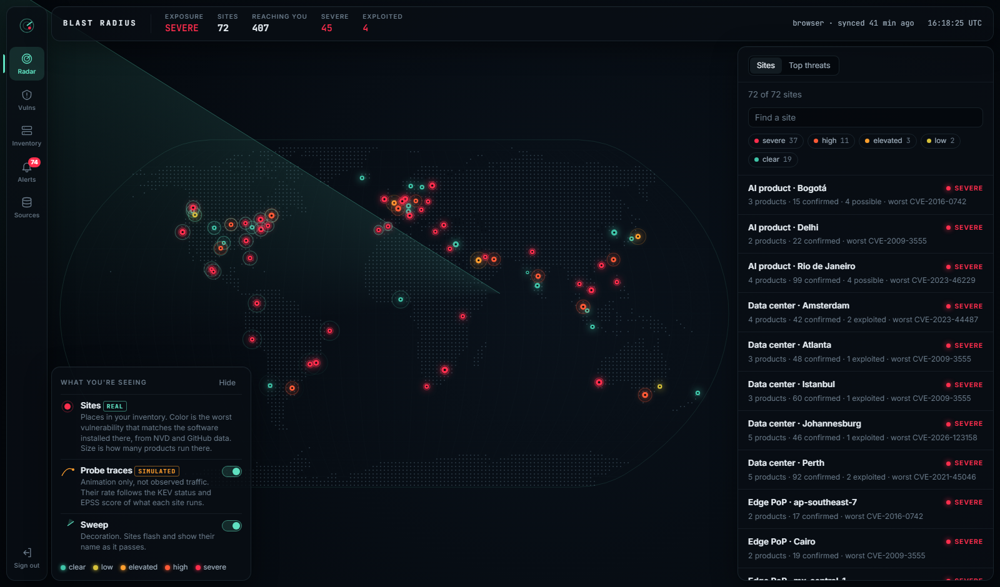
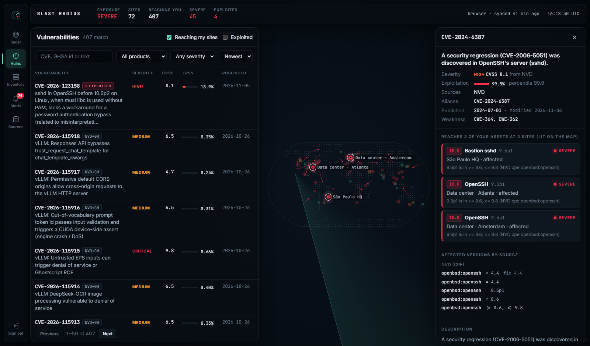
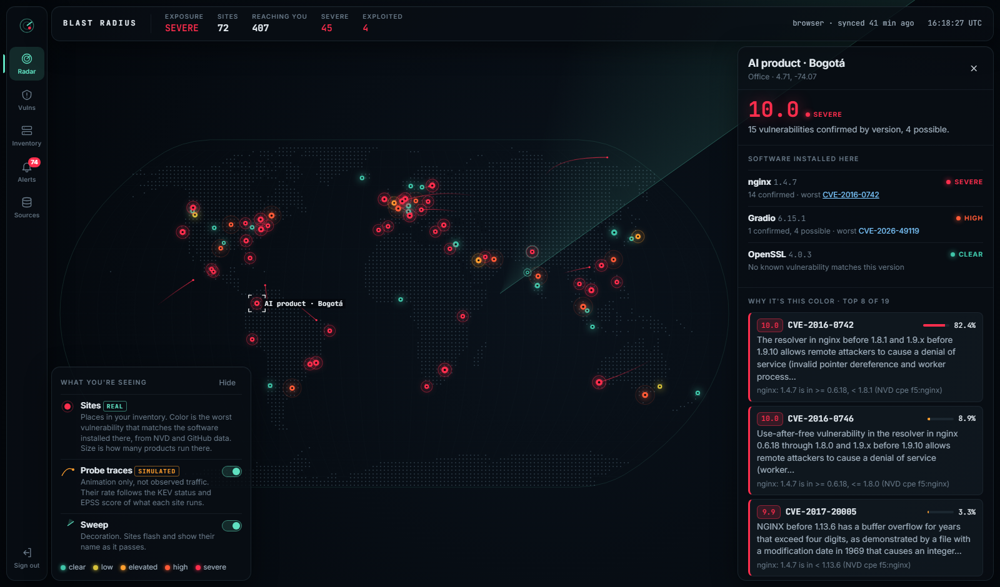
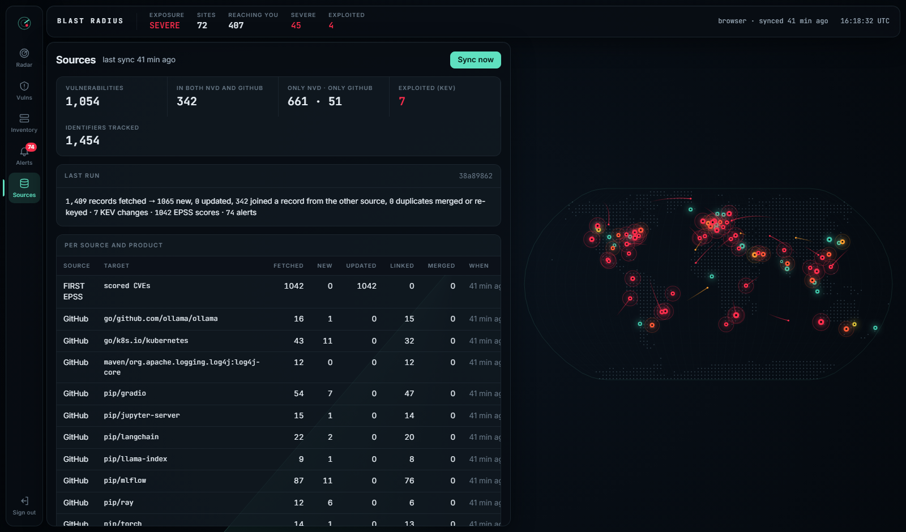

# Blast Radius

Which of your sites does each published vulnerability reach? Blast Radius pulls advisories from NVD and the GitHub Advisory Database, merges the two into one record per vulnerability, adds exploitation signals from CISA KEV and FIRST EPSS, matches the result against the software you run at each site, and alerts you when that picture changes.

ASP.NET Core 10 API (Entity Framework Core, PostgreSQL, JWT auth) and a React client. The GitHub Pages build has no server: it runs a TypeScript port of the API in the browser, calls the same public APIs directly, and passes the same contract scenario as the C# code.

[Open the browser build](https://arthurgaspar.github.io/blast-radius/) · [How matching works](#matching) · [API](#api)



## Using it

The world map is the application: it fills the window, and every view is a panel docked around it, so the map stays live while you work.

The browser build opens with a demo account (filled in on the sign-in screen): 72 sites around the world running AI and infrastructure software. Six are written by hand:

| Site | Running | What the real data says |
|---|---|---|
| Inference cluster | Ollama 0.1.33, vLLM 0.11.0, Ray 2.40.0, nginx | Ollama's CVE-2024-37032 ("Probllama"); Ray's CVE-2025-62593, in CISA KEV since 2026-08-17 |
| Training cluster | PyTorch 2.5.1, Ray, MLflow, Kubernetes (current) | PyTorch's `torch.load` RCE, CVE-2025-32434 |
| São Paulo HQ | OpenSSH 9.6p1, Gradio, LangChain | regreSSHion, CVE-2024-6387 |
| Tokyo research lab | Transformers, LlamaIndex (current), Jupyter Server (version unknown) | only *possible* matches, from the unknown version |
| Frankfurt data center, Singapore edge | current Log4j, OpenSSL, nginx | clear |

The other 66 are generated from site templates (inference, training, research, AI product, office, data center, edge) and a patch-hygiene profile per site. Versions aren't invented: for each product, the generator collects the release numbers that the vulnerability data itself names (fixed-in versions and range bounds) and picks newer or older ones by hygiene. So every color on the map comes from real matching against real releases.

**Radar.** Each dot is a site from your inventory, colored by the worst vulnerability matching the software installed there and sized by how many products run there. The key in the corner says what is real and what isn't:
- **Sites:** real.
- **Probe traces:** a *simulation*. Their rate follows the KEV status and EPSS scores of what each site runs, and they don't represent observed traffic. They can be switched off, as can the sweep.

The drawer lists sites, filterable by danger level, and the top threats. Clicking a site shows the software and versions installed there and the vulnerabilities behind its color, ranked by their score at that site.

**Vulnerabilities.** Every ingested record, searchable by CVE, GHSA id or text, filterable by product, severity, KEV and "reaches my sites". The detail panel shows:
- which sources reported it, and every alias;
- the CVSS score and where it came from;
- EPSS, and the KEV entry (date added, due date, ransomware use, required action);
- each source's affected-version ranges;
- each of your assets it reaches, with the reason in words ("0.1.33 is in < 0.1.34 (NVD cpe ollama:ollama)").

Opening a GitHub id that was merged into a CVE redirects to the CVE record and says so.

Opening a vulnerability lights up the sites it reaches on the map and dims the rest.





**Inventory.** Sites (a preset location or coordinates) and the software at each. Pick from the catalog (10 AI/ML products, 5 infrastructure products) or enter any package (`pip/fastapi`) or CPE (`tiangolo:fastapi`); custom identities join the watch list on the next sync. Edit a version and exposure recalculates on the spot.

**Alerts.** Subscriptions filter by scope (all sites, one site, one product), minimum severity, KEV only, minimum EPSS and keyword, and can post to a webhook. Each one previews what it would catch today. The inbox lists what ingestion found: new exposures, vulnerabilities newly added to KEV, severity increases.

**Sources.** What the last sync did per source and product (fetched, new, updated, joined across sources, merged), totals by source, and a **Sync now** button. In the browser build it calls NVD, GitHub, KEV and EPSS from your browser.



## Matching

### Deduplication

NVD and GitHub often describe the same flaw. Every record carries all its identifiers. An advisory that shares any identifier with an existing record joins it, and an alias table enforces one owner per identifier. Merge rules:

- **Title:** GitHub's summary; otherwise the first sentence of the description.
- **Description and CVSS:** NVD's win. GitHub fills in what NVD lacks. Ollama's CVE-2024-37032 is "medium" on GitHub and 8.8 on NVD; the record shows 8.8, attributed to NVD.
- **Version ranges:** each source owns its own. An update from one source replaces only that source's ranges. A withdrawn GitHub advisory drops GitHub's ranges and leaves NVD's.
- **Re-keying:** a GitHub advisory without a CVE is stored under its GHSA id. When the CVE appears, the record is re-keyed to it and merged with NVD's copy. Alerts that pointed at the old id move with it, so nothing alerts twice.

Merging is order-independent, and re-applying an unchanged advisory changes nothing. Both properties are tested. On today's data, 1,409 fetched advisories become 1,054 vulnerabilities: 342 reported by both sources, 661 only by NVD, 51 only by GitHub.

### Versions and ranges

Versions are compared without knowing their ecosystem:

- **Pre-releases:** `1.0rc1 < 1.0`, and PEP 440's `dev < a < b < rc`.
- **Post-releases:** `.post1`.
- **OpenSSL letter suffixes:** `1.0.1f < 1.0.1g`, the Heartbleed fix.
- **OpenSSH patch levels:** `9.8p1`.
- **Build metadata** after `+` is ignored.

GitHub's range strings (`>= 2.49.0, < 2.55.0`) and NVD's CPE bounds become the same structure. A CPE with a concrete version and update (`openssh:9.7:p1`) becomes an exact match on `9.7p1`.

Three rules come from problems found in the real data:

- **Specific beats vague.** NVD sometimes names a product with no version bounds at all. CVE-2023-6018 lists MLflow that way, while GitHub says `<= 2.8.1`. When any source gives bounds, the bounds decide. An unbounded statement alone says nothing about a known version (no match), and means *possible* only when the version is unknown. Without this, ancient OpenSSH CVEs flagged OpenSSH 10, and a single site showed 300+ "possible" OpenSSL matches.
- **Dates aren't versions.** Some NVD ranges use release dates (`< 2025-06-10`). A date and `3.17.2` can't be ordered, so the result is *possible*, not *affected*.
- **Unknown version.** An asset with no version recorded is *possible* for anything its product has had.

### Danger

```
score = CVSS (or a severity fallback) + 2 if in CISA KEV + 3 × EPSS, capped at 10
        × 0.6 when the match is only possible
severe ≥ 9 · high ≥ 7 · elevated ≥ 4 · low > 0 · clear
```

A site's level is the worst score among its matches. Red is used only for danger.

### Alerts

Raised by ingestion, never by editing the inventory:

- **New exposure:** a vulnerability newly reaches one of your assets.
- **Now exploited:** a matched vulnerability was added to KEV.
- **Severity raised:** a matched vulnerability's severity went up.

Each subscription alerts at most once per vulnerability and reason. Only matches backed by a version range, or by an asset with no recorded version, raise alerts; date-shaped versions that can't be compared show up as *possible* but don't page anyone.

Webhooks post a JSON batch per subscription and run. The URL is checked when saved and again after DNS resolution at send time. Loopback, private ranges, link-local and cloud metadata (`169.254.169.254`), carrier-grade NAT, multicast and IPv4-mapped IPv6 forms are refused, and redirects aren't followed. Every attempt is logged with its outcome. The browser build records webhooks without sending them: browsers can't post to arbitrary hosts.

## Running

### Browser build

```bash
cd web
npm ci
npm run dev            # http://localhost:5173
```

The first visit loads `web/public/data/snapshot.json` (written by the API's `snapshot` command; refreshed daily by CI) and keeps everything in IndexedDB. **Sync now** calls the live sources:

- **NVD:** 5 requests per 30 seconds without a key, so a full pass takes about two minutes. Later passes fetch only what changed.
- **GitHub:** 60 requests per hour per IP without a token. Syncs only ask for advisories modified since the last one.

### API

.NET 10 SDK and Node 22. SQLite by default, so nothing else is needed:

```bash
cd api
dotnet run --project src/BlastRadius.Api      # http://localhost:5190, ingests on start and every 6 h

cd web
npm run dev:api                               # client pointed at :5190
```

For PostgreSQL, set `Database__Provider=postgres` and `ConnectionStrings__Default`; migrations run on start. Settings worth knowing:

| Setting | |
|---|---|
| `Jwt__Secret` | 32+ bytes. Change it anywhere shared. |
| `Sources__NvdApiKey` | Optional. [Free key](https://nvd.nist.gov/developers/request-an-api-key); allows 50 requests per 30 seconds. |
| `Sources__GithubToken` | Optional. Any token, no scopes; 5,000 requests/hour. |
| `Ingestion__IntervalHours`, `Ingestion__ManualCooldownMinutes` | Schedule, and the minimum gap between manual runs (default 10 min). |
| `Webhooks__AllowPrivateTargets` | Local development only. |

`dotnet run --project src/BlastRadius.Api -- snapshot <file>` runs one live ingestion and writes the snapshot the browser build starts from.

### Docker

```bash
docker compose up --build    # web :5173, API :8080, PostgreSQL in a volume
```

## Tests

```bash
cd api && dotnet test        # xUnit: contract scenario (SQLite; PostgreSQL via Testcontainers when Docker is there), vectors, merge, security, webhooks
cd web && npm test           # Vitest: the same contract scenario, vectors and merge tests
```

- **`shared/fixtures/`**: real NVD, GitHub, KEV and EPSS responses for Ollama and Ray, recorded on 2026-11-12. `day1` is the same data before two real events: Ray's CVE-2025-62593 entering KEV, and GHSA-hhrp-gw25-jr43 receiving CVE-2026-57516. Its README says exactly what was removed.
- **`shared/contract/scenario.json`**: 47 steps through the API on that data. It covers auth and isolation between accounts, inventory, SSRF refusals, and day-1 ingestion: the GHSA id resolving to the CVE with NVD's score, the withdrawn advisory matching nothing, and re-running changing nothing. Then day 2: exactly two "now exploited" alerts and the GitHub-only record re-keyed without a duplicate alert. It runs against the API on SQLite, the API on PostgreSQL, and the browser engine.
- **`shared/vectors.json`**: version comparisons, GitHub and NVD ranges, cross-source precedence, package-name normalization and danger scores, asserted by both implementations.
- **Other tests:** merge order independence on recorded data; webhook delivery, failure and refusal against a fake receiver; resolve-time SSRF blocking; expired and forged tokens; sign-in rate limiting; the manual-sync cooldown.

## API

All under `/api`; everything except auth and `/catalog` needs `Authorization: Bearer <token>`. Errors are RFC 7807 problem details with a stable `code`. The OpenAPI document is at `/openapi/v1.json`.

| | |
|---|---|
| `POST /auth/register`, `POST /auth/login`, `GET /me` | Accounts (rate-limited) |
| `GET /catalog` | Products and site presets |
| `GET/POST /sites`, `PUT/DELETE /sites/{id}`, `GET/POST /assets`, `PUT/DELETE /assets/{id}` | Inventory |
| `GET /exposure?site=` | Sites with danger levels, and ranked threats (what the radar draws); `site` scopes the threats to one site |
| `GET /vulnerabilities?q=&product=&severity=&kev=&minEpss=&matched=&sort=&page=`, `GET /vulnerabilities/{id or alias}` | Catalog and detail |
| `GET/POST /subscriptions`, `PUT/DELETE /subscriptions/{id}`, `GET …/{id}/preview`, `POST …/{id}/test` | Subscriptions |
| `GET /notifications?unread=`, `POST /notifications/{id}/read`, `POST /notifications/read-all`, `GET /deliveries` | Inbox and webhook log |
| `GET /ingestion/status`, `GET /ingestion/runs`, `POST /ingestion/run?wait=` | Ingestion |

## Structure

```text
shared/catalog.json             watched products (verified CPE and package identities) and site presets
shared/vectors.json             matching rules both implementations assert
shared/fixtures/                recorded source responses (day1, day2)
shared/contract/scenario.json   the contract scenario
api/src/BlastRadius.Api/
  Matching/                     versions, ranges, identities, danger
  Ingestion/                    NVD, GitHub, KEV, EPSS clients; normalization, merge rules, ingestion, snapshot command
  Exposure/                     matches and their explanations
  Notifications/                subscription filters, alerts, webhooks, SSRF guard
  Http/                         endpoints
  Data/                         EF Core model and PostgreSQL migration
web/src/engine/                 the TypeScript port
web/src/WorldRadar.tsx          the map (d3-geo, canvas; dot-matrix land, layers, highlighting)
web/src/api/demo.ts             the 72-site demo inventory, versions drawn from the data
```

## Limits

- Matching works on product identities and versions. It doesn't know about configuration, exposure to the network, or backported fixes in distribution packages (a patched Debian OpenSSH still reports its upstream version).
- NVD configurations that combine products ("X running on Y") are reduced to their vulnerable entries.
- Coverage follows the watch list: the catalog plus the identities you enter. It isn't a full mirror of NVD.
- The browser build keeps data in one browser, can't send webhooks, and uses the anonymous rate limits.
- Probe traces on the map are simulated; site colors are not. The demo inventory is generated, but its versions and their matches are real.

Created by [Arthur Gaspar](https://github.com/arthurgaspar).
